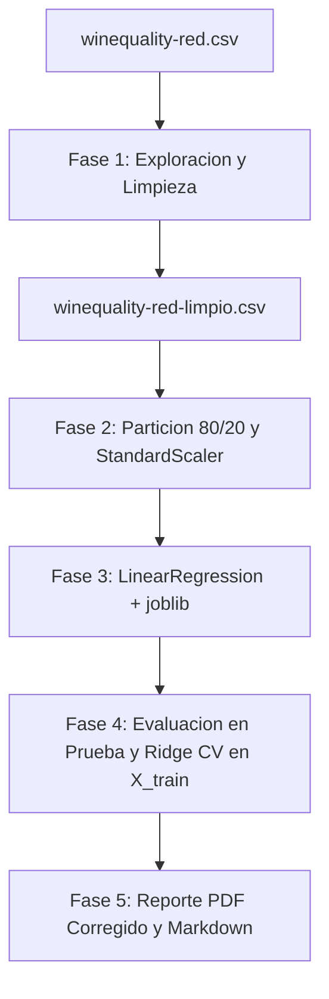

# Desarrollo y evaluación de un modelo de aprendizaje supervisado para la predicción de la calidad del vino tinto mediante regresión lineal múltiple

**Universidad:** Universidad Autónoma de Tamaulipas (UAT)  
**Facultad:** Facultad de Ingeniería Tampico (FIT)  
**Carrera:** Ingeniería en Sistemas Computacionales  
**Materia:** INTELIGENCIA ARTIFICIAL  
**Tipo de trabajo:** PROYECTO FINAL  

**Integrantes:**
- Francisco Mogollón José Antonio
- Gómez Sánchez Haziel Emiliano
- Hernández González Brian Satihs

**Profesor:** Martínez Ponce Mario Alberto  
**Lugar y fecha:** Tampico, Tamaulipas, México — 23 de noviembre de 2026

---

## Resumen

Este reporte documenta el desarrollo, entrenamiento y evaluación de un modelo de aprendizaje supervisado de regresión para estimar la calidad del vino tinto a partir de variables fisicoquímicas. Se empleó el conjunto Wine Quality (Red Wine) del repositorio UCI, integrado por 1,599 registros y 12 columnas numéricas. Tras comprobar cero valores nulos y retirar 240 filas duplicadas para prevenir fuga entre particiones, se conservaron 1,359 observaciones con 11 predictores y la puntuación numérica discreta ordinal quality tratada como respuesta cuantitativa. Se aplicó una partición aleatoria 80/20 (1,087 entrenamiento y 272 prueba) y estandarización mediante StandardScaler ajustado exclusivamente en entrenamiento, entrenándose un modelo de Regresión Lineal Múltiple por mínimos cuadrados ordinarios. En el conjunto de prueba se obtuvo MSE = 0.4310, RMSE = 0.6565, MAE = 0.5041 y R² = 0.3915, mejorando frente al predictor de media constante (RMSE = 0.8443) sin brecha pronunciada respecto a entrenamiento en esta partición. Adicionalmente, una validación cruzada 5-fold exclusiva sobre entrenamiento mostró desempeño similar entre LinearRegression (RMSE = 0.6684) y Ridge (alpha de 0.01 a 100), por lo que se conservó LinearRegression para muestras afines al conjunto estudiado.

**Palabras clave:** Inteligencia Artificial, Machine Learning, Regresión Lineal Múltiple, Wine Quality, StandardScaler, Ridge, Validación Cruzada.

---

## 1. Introducción

La Inteligencia Artificial (IA) comprende el diseño de sistemas capaces de ejecutar inferencias y resolver problemas complejos a partir de datos (Russell & Norvig, 2021). El aprendizaje automático ajusta modelos matemáticos desde observaciones históricas, y dentro del aprendizaje supervisado la regresión resulta adecuada para estimar variables continuas u ordinales cuantitativas graduadas (James et al., 2023). En el contexto vitivinícola, modelar la relación entre mediciones fisicoquímicas y calidad sensorial apoya el control objetivo en laboratorio (Cortez et al., 2009a).

## 2. Planteamiento del problema

Se plantea estimar la puntuación de calidad del vino tinto (`quality`) a partir de 11 variables fisicoquímicas. Se eligió regresión en lugar de clasificación porque `quality` es una **puntuación numérica discreta de naturaleza ordinal** (escala 0–10, observada en enteros de 3 a 8) tratada como **respuesta cuantitativa**, cuyas distancias ordinales se perderían al discretizar en clases.

## 3. Objetivos

- **General:** Desarrollar, entrenar y evaluar críticamente un modelo de Regresión Lineal Múltiple para predecir la calidad del vino tinto a partir de sus propiedades fisicoquímicas.
- **Específicos:** Explorar el dataset original; limpiar duplicados exactos conservando observaciones atípicas ante la ausencia de evidencia de error; preparar partición 80/20 con `StandardScaler` sin fuga de datos; entrenar `LinearRegression`; evaluar con `MSE`, `RMSE`, `MAE`, `R²`, residuos y modelo base; realizar un análisis complementario con `Ridge` y validación cruzada; e interpretar limitaciones y alcances dentro de la evidencia medida.

## 4. Marco teórico

Incluye fundamentos de Inteligencia Artificial (Russell & Norvig, 2021), aprendizaje automático y supervisado (James et al., 2023), diferenciación entre clasificación y regresión, regresión lineal simple ($\hat{y} = \beta_0 + \beta_1 x$), regresión lineal múltiple ($\hat{y} = b_0 + \sum_{j=1}^p b_j x_j$), mínimos cuadrados ordinarios ($\min_b \sum (y_i - \hat{y}_i)^2$), preprocesamiento (McKinney, 2010), estandarización $z_j = (x_j - \mu_j)/\sigma_j$ (scikit-learn developers, 2026), fuga de datos, sobreajuste/subajuste y métricas de regresión (definiendo `MSE` como el promedio de los errores elevados al cuadrado):

$$\text{MSE} = \frac{1}{n}\sum (y_i - \hat{y}_i)^2, \quad \text{RMSE} = \sqrt{\text{MSE}}, \quad \text{MAE} = \frac{1}{n}\sum |y_i - \hat{y}_i|, \quad R^2 = 1 - \frac{\sum (y_i - \hat{y}_i)^2}{\sum (y_i - \bar{y})^2}$$

## 5. Herramientas y tecnologías

Se emplearon Python `3.14.0`, pandas (`3.1.1`), NumPy (`2.5.5`), Matplotlib (`3.11.2`), Seaborn (`0.13.2`), Scikit-learn (`1.9.1`), Joblib (`1.6.0`), ReportLab (`5.1.0`), Pillow (`13.0.0`), PyCharm y Antigravity (Harris et al., 2020; Hunter, 2007; pandas development team, 2026; Pedregosa et al., 2011; Waskom, 2021).

## 6. Descripción del conjunto de datos

Dataset *Wine Quality (Red Wine)* del UCI Machine Learning Repository (Cortez et al., 2009b), enlace https://archive.ics.uci.edu/dataset/186/wine+quality, DOI https://doi.org/10.24432/C56S3T. Contiene 1,599 registros originales y 12 columnas numéricas (11 variables independientes `X` y la variable objetivo numérica discreta de naturaleza ordinal `y = quality`).

## 7. Fase 1: Exploración, limpieza y análisis de datos

Se eliminaron 240 duplicados exactos obteniendo 1,359 registros únicos y 0 valores faltantes. Las observaciones detectadas por el método IQR (por debajo de `Q1 - 1.5*IQR` o por encima de `Q3 + 1.5*IQR`, incluyendo valores en ambos extremos en `density`: 18 inf. / 17 sup., `pH`: 11 inf. / 17 sup. y `chlorides`: 4 inf. / 83 sup.) se conservaron debido a la ausencia de evidencia suficiente para considerarlas errores.

| Característica | Antes | Después |
| --- | --- | --- |
| Registros | 1599 | 1359 |
| Columnas | 12 | 12 |
| Valores faltantes | 0 | 0 |
| Duplicados | 240 | 0 |

| Variable | Cantidad | Media | Desviación estándar | Mínimo | Q1 (25%) | Mediana (50%) | Q3 (75%) | Máximo |
| --- | --- | --- | --- | --- | --- | --- | --- | --- |
| fixed acidity | 1359 | 8.3106 | 1.7370 | 4.6000 | 7.1000 | 7.9000 | 9.2000 | 15.9000 |
| volatile acidity | 1359 | 0.5295 | 0.1830 | 0.1200 | 0.3900 | 0.5200 | 0.6400 | 1.5800 |
| citric acid | 1359 | 0.2723 | 0.1955 | 0 | 0.0900 | 0.2600 | 0.4300 | 1 |
| residual sugar | 1359 | 2.5234 | 1.3523 | 0.9000 | 1.9000 | 2.2000 | 2.6000 | 15.5000 |
| chlorides | 1359 | 0.0881 | 0.0494 | 0.0120 | 0.0700 | 0.0790 | 0.0910 | 0.6110 |
| free sulfur dioxide | 1359 | 15.8933 | 10.4473 | 1 | 7 | 14 | 21 | 72 |
| total sulfur dioxide | 1359 | 46.8260 | 33.4089 | 6 | 22 | 38 | 63 | 289 |
| density | 1359 | 0.9967 | 0.0019 | 0.9901 | 0.9956 | 0.9967 | 0.9978 | 1.0037 |
| pH | 1359 | 3.3098 | 0.1550 | 2.7400 | 3.2100 | 3.3100 | 3.4000 | 4.0100 |
| sulphates | 1359 | 0.6587 | 0.1707 | 0.3300 | 0.5500 | 0.6200 | 0.7300 | 2 |
| alcohol | 1359 | 10.4323 | 1.0821 | 8.4000 | 9.5000 | 10.2000 | 11.1000 | 14.9000 |
| quality | 1359 | 5.6233 | 0.8236 | 3 | 5 | 6 | 6 | 8 |

| Calidad | Cantidad | Porcentaje (%) |
| --- | --- | --- |
| 3 | 10 | 0.74 |
| 4 | 53 | 3.90 |
| 5 | 577 | 42.46 |
| 6 | 535 | 39.37 |
| 7 | 167 | 12.29 |
| 8 | 17 | 1.25 |

| Variable | Correlación con quality |
| --- | --- |
| alcohol | 0.4803 |
| sulphates | 0.2488 |
| citric acid | 0.2281 |
| fixed acidity | 0.1190 |
| residual sugar | 0.0136 |
| free sulfur dioxide | -0.0505 |
| pH | -0.0552 |
| chlorides | -0.1310 |
| total sulfur dioxide | -0.1779 |
| density | -0.1843 |
| volatile acidity | -0.3952 |

| Variable | Q1 | Q3 | IQR | Límite inferior | Límite superior | Valores atípicos | Porcentaje (%) |
| --- | --- | --- | --- | --- | --- | --- | --- |
| fixed acidity | 7.1000 | 9.2000 | 2.1000 | 3.9500 | 12.3500 | 41 | 3.0200 |
| volatile acidity | 0.3900 | 0.6400 | 0.2500 | 0.0150 | 1.0150 | 19 | 1.4000 |
| citric acid | 0.0900 | 0.4300 | 0.3400 | -0.4200 | 0.9400 | 1 | 0.0700 |
| residual sugar | 1.9000 | 2.6000 | 0.7000 | 0.8500 | 3.6500 | 126 | 9.2700 |
| chlorides | 0.0700 | 0.0910 | 0.0210 | 0.0385 | 0.1225 | 87 | 6.4000 |
| free sulfur dioxide | 7 | 21 | 14 | -14 | 42 | 26 | 1.9100 |
| total sulfur dioxide | 22 | 63 | 41 | -39.5000 | 124.5000 | 45 | 3.3100 |
| density | 0.9956 | 0.9978 | 0.0022 | 0.9923 | 1.0011 | 35 | 2.5800 |
| pH | 3.2100 | 3.4000 | 0.1900 | 2.9250 | 3.6850 | 28 | 2.0600 |
| sulphates | 0.5500 | 0.7300 | 0.1800 | 0.2800 | 1 | 55 | 4.0500 |
| alcohol | 9.5000 | 11.1000 | 1.6000 | 7.1000 | 13.5000 | 12 | 0.8800 |

Gráficas asociadas: `../resultados/graficas/01_distribucion_calidad.png` a `06_dispersion_calidad.png`.

## 8. Fase 2: Preparación y partición de los datos

División aleatoria 80/20 con `random_state=42` (`1,087` entrenamiento / `272` prueba) por ausencia de variable temporal o identificadores individuales/grupales (sin comprobar independencia estadística entre muestras, aunque se verificaron `0` índices compartidos y `0` vectores `X` idénticos compartidos entre entrenamiento y prueba) y estandarización con `StandardScaler` (`fit_transform()` solo en `X_train`, `transform()` en `X_test`).

| Conjunto | Registros | Porcentaje (%) | Columnas X | Dimensiones X | Dimensiones y | Semilla aleatoria |
| --- | --- | --- | --- | --- | --- | --- |
| Entrenamiento | 1087 | 79.99 | 11 | (1087, 11) | (1087,) | 42 |
| Prueba | 272 | 20.01 | 11 | (272, 11) | (272,) | 42 |
| Total | 1359 | 100 | 11 | (1359, 11) | (1359,) | 42 |

| Variable | Media antes (train) | Desv. est. antes (train) | Media después (train) | Desv. est. después (train) |
| --- | --- | --- | --- | --- |
| fixed acidity | 8.2934 | 1.7252 | 0.0000 | 1 |
| volatile acidity | 0.5277 | 0.1784 | -0.0000 | 1 |
| citric acid | 0.2733 | 0.1953 | -0.0000 | 1 |
| residual sugar | 2.5255 | 1.3651 | -0.0000 | 1 |
| chlorides | 0.0896 | 0.0525 | 0.0000 | 1 |
| free sulfur dioxide | 15.7406 | 10.3311 | -0.0000 | 1 |
| total sulfur dioxide | 46.8491 | 33.2848 | 0.0000 | 1 |
| density | 0.9967 | 0.0019 | -0.0000 | 1 |
| pH | 3.3095 | 0.1522 | -0.0000 | 1 |
| sulphates | 0.6597 | 0.1738 | -0.0000 | 1.0000 |
| alcohol | 10.4355 | 1.0909 | -0.0000 | 1 |

## 9. Fase 3: Entrenamiento del modelo

Modelo `LinearRegression` entrenado solo con `X_train_escalado` e `y_train`. Intercepto: `5.636615`. La notación `z(variable)` indica cada predictor estandarizado:

```text
ŷ = 5.6366 − 0.0497·z(fixed acidity) − 0.1785·z(volatile acidity) − 0.0191·z(citric acid) − 0.0052·z(residual sugar) − 0.1160·z(chlorides) + 0.0487·z(free sulfur dioxide) − 0.1236·z(total sulfur dioxide) + 0.0421·z(density) − 0.1215·z(pH) + 0.1485·z(sulphates) + 0.3340·z(alcohol)
```

| Variable | Coeficiente | Valor absoluto del coeficiente | Signo del coeficiente |
| --- | --- | --- | --- |
| alcohol | 0.3340 | 0.3340 | Positivo |
| volatile acidity | -0.1785 | 0.1785 | Negativo |
| sulphates | 0.1485 | 0.1485 | Positivo |
| total sulfur dioxide | -0.1236 | 0.1236 | Negativo |
| pH | -0.1215 | 0.1215 | Negativo |
| chlorides | -0.1160 | 0.1160 | Negativo |
| fixed acidity | -0.0497 | 0.0497 | Negativo |
| free sulfur dioxide | 0.0487 | 0.0487 | Positivo |
| density | 0.0421 | 0.0421 | Positivo |
| citric acid | -0.0191 | 0.0191 | Negativo |
| residual sugar | -0.0052 | 0.0052 | Negativo |

## 10. Fase 4: Evaluación del rendimiento y validación cruzada

### 10.1 Evaluación del modelo principal en prueba (`n = 272`)

`RMSE = 0.6565` corresponde a la raíz cuadrada aproximada de `MSE = 0.4310` debido al redondeo a cuatro decimales (valor completo `0.431009`). El `R² = 0.3915` deja `60.85%` de variabilidad no explicada sin causas atribuibles directamente desde esta métrica.

| Métrica | Valor | Fórmula | Descripción |
| --- | --- | --- | --- |
| MSE | 0.4310 | MSE = (1/n) * suma((y_real - y_pred)^2) | Promedio de errores al cuadrado; penaliza errores grandes (unidades de calidad al cuadrado). |
| RMSE | 0.6565 | RMSE = raiz_cuadrada(MSE) | Raíz del MSE; error típico expresado en la misma escala que la calidad del vino. |
| MAE | 0.5041 | MAE = (1/n) * suma(abs(y_real - y_pred)) | Promedio de diferencias absolutas; indica cuántos puntos de calidad se equivoca en promedio. |
| R² | 0.3915 | R² = 1 - (suma((y_real - y_pred)^2) / suma((y_real - media)^2)) | Proporción de variabilidad de quality explicada por el modelo (no es un porcentaje de exactitud de clasificación). |

| Estadística | Valor | Interpretación |
| --- | --- | --- |
| Media de los residuos | -0.0677 | Sesgo promedio en prueba (>0 subestima, <0 sobreestima). |
| Mediana de los residuos | -0.0966 | Valor central de los residuos en prueba. |
| Desviación estándar | 0.6542 | Dispersión muestral (ddof=1) de los residuos. |
| Residuo mínimo | -2.2067 | Mayor sobreestimación (Calidad_real - Calidad_predicha). |
| Residuo máximo | 1.9077 | Mayor subestimación (Calidad_real - Calidad_predicha). |
| Cantidad de residuos positivos | 122 | Registros donde el modelo subestimó la calidad (residuo > 1e-06). |
| Cantidad de residuos negativos | 150 | Registros donde el modelo sobreestimó la calidad (residuo < -1e-06). |
| Cantidad de residuos iguales a cero | 0 | Predicciones dentro de la tolerancia |residuo| <= 1e-06. |

| Métrica | Entrenamiento | Prueba |
| --- | --- | --- |
| MSE | 0.4337 | 0.4310 |
| RMSE | 0.6585 | 0.6565 |
| MAE | 0.5107 | 0.5041 |
| R² | 0.3520 | 0.3915 |

| Métrica | Modelo base (DummyRegressor) | Regresión Lineal Múltiple | Diferencia (RLM - Base) |
| --- | --- | --- | --- |
| MSE | 0.7128 | 0.4310 | -0.2818 |
| RMSE | 0.8443 | 0.6565 | -0.1878 |
| MAE | 0.7049 | 0.5041 | -0.2007 |
| R² | -0.0063 | 0.3915 | 0.3978 |

| Calidad_real | Cantidad_registros | Promedio_predicciones | MAE | RMSE | Residuo_promedio |
| --- | --- | --- | --- | --- | --- |
| 3 | 4 | 5.0466 | 2.0466 | 2.0531 | -2.0466 |
| 4 | 11 | 5.3208 | 1.3208 | 1.3475 | -1.3208 |
| 5 | 120 | 5.3738 | 0.4145 | 0.5042 | -0.3738 |
| 6 | 103 | 5.8046 | 0.3459 | 0.4323 | 0.1954 |
| 7 | 31 | 6.2045 | 0.7955 | 0.8833 | 0.7955 |
| 8 | 3 | 6.5400 | 1.4600 | 1.4680 | 1.4600 |

### 10.2 Experimentación complementaria: Ridge con validación cruzada (`X_train`, 5-fold)

Evaluación complementaria exclusiva sobre `X_train` sin escalar (`1,087` registros) mediante `Pipeline(StandardScaler -> Modelo)` y `KFold(n_splits=5, shuffle=True, random_state=42)`, sin tocar el conjunto de prueba ni sustituir `LinearRegression`:

| Modelo | Alpha | RMSE_promedio_CV | RMSE_desv_est_CV | R2_promedio_CV | R2_desv_est_CV | Particiones_CV | Registros_entrenamiento |
| --- | --- | --- | --- | --- | --- | --- | --- |
| LinearRegression | N/A (OLS) | 0.6684 | 0.0299 | 0.3209 | 0.0600 | 5 | 1087 |
| Ridge | 0.01 | 0.6684 | 0.0299 | 0.3209 | 0.0600 | 5 | 1087 |
| Ridge | 0.1 | 0.6684 | 0.0299 | 0.3210 | 0.0600 | 5 | 1087 |
| Ridge | 1 | 0.6684 | 0.0300 | 0.3211 | 0.0600 | 5 | 1087 |
| Ridge | 10 | 0.6680 | 0.0309 | 0.3220 | 0.0593 | 5 | 1087 |
| Ridge | 100 | 0.6679 | 0.0340 | 0.3227 | 0.0542 | 5 | 1087 |

Gráfica asociada: `../resultados/graficas/21_comparacion_ridge_cv.png`.

## 11. Funcionamiento del programa

Ejecución portable en cualquier computadora mediante rutas relativas (`utilidades.py`):

```bash
python -m venv .venv
# Windows PowerShell: .\.venv\Scripts\Activate.ps1  |  Linux/macOS: source .venv/bin/activate
pip install -r requirements.txt
python main.py
```

Fragmento clave del entrenamiento (`Entrenamiento_Modelo.py`):

```python
modelo = LinearRegression()
modelo.fit(X_train_escalado, y_train)
```



## 12. Discusión de resultados

En la partición 80/20 evaluada (`MAE = 0.5041`, `RMSE = 0.6565`, `R² = 0.3915`) se supera a `DummyRegressor` (`RMSE = 0.8443`, `R² = -0.0063`) sin observarse una brecha pronunciada frente a entrenamiento (`R² = 0.3520`). El `R²` moderado sugiere capacidad predictiva lineal limitada sin demostrar por sí solo subajuste, mientras que en validación cruzada (`X_train`) `LinearRegression` (`RMSE = 0.6684 ± 0.0299`) y `Ridge` obtienen resultados casi idénticos.

## 13. Limitaciones y trabajos futuros

Concentración del `81.99%` de los registros de prueba en notas 5 y 6, escasez en notas extremas (3 y 8), ausencia de identificadores para probar independencia muestral (`0` vectores `X` idénticos compartidos), `60.85%` de variabilidad no explicada, subjetividad sensorial, multicolinealidad y alcance restringido a datos similares al vino tinto *Vinho Verde* evaluado. Trabajos futuros: Lasso/ElasticNet, términos polinómicos/interacciones, regresión ordinal y Random Forest / Gradient Boosting.

## 14. Conclusiones

La evidencia medida en la partición evaluada y la validación cruzada 5-fold muestra un comportamiento estable de `LinearRegression` por encima del promedio constante, pero con capacidad predictiva moderada y errores altos en calidades extremas, por lo que su utilidad se restringe a línea base orientativa en muestras comparables al conjunto estudiado.

## 15. Referencias bibliográficas

Cortez, P., Cerdeira, A., Almeida, F., Matos, T., & Reis, J. (2009a). Modeling wine preferences by data mining from physicochemical properties. *Decision Support Systems*, *47*(4), 547–553. https://doi.org/10.1016/j.dss.2009.05.016

Cortez, P., Cerdeira, A., Almeida, F., Matos, T., & Reis, J. (2009b). *Wine Quality* [Conjunto de datos]. UCI Machine Learning Repository. https://doi.org/10.24432/C56S3T

Harris, C. R., Millman, K. J., van der Walt, S. J., Gommers, R., Virtanen, P., Cournapeau, D., Wieser, E., Taylor, J., Berg, S., Smith, N. J., Kern, R., Picus, M., Hoyer, S., van Kerkwijk, M. H., Brett, M., Haldane, A., Fernández del Río, J., Wiebe, M., Peterson, P., ... Oliphant, T. E. (2020). Array programming with NumPy. *Nature*, *585*(7825), 357–362. https://doi.org/10.1038/s41586-020-2649-2

Hunter, J. D. (2007). Matplotlib: A 2D graphics environment. *Computing in Science & Engineering*, *9*(3), 90–95. https://doi.org/10.1109/MCSE.2007.55

James, G., Witten, D., Hastie, T., Tibshirani, R., & Taylor, J. (2023). *An introduction to statistical learning: With applications in Python*. Springer. https://doi.org/10.1007/978-3-031-38747-0

McKinney, W. (2010). Data structures for statistical computing in Python. En S. van der Walt & J. Millman (Eds.), *Proceedings of the 9th Python in Science Conference* (pp. 56–61). https://doi.org/10.25080/Majora-92bf1922-00a

pandas development team. (2026). *pandas documentation* (Versión 3.1.1) [Manual técnico]. https://pandas.pydata.org/docs/

Pedregosa, F., Varoquaux, G., Gramfort, A., Michel, V., Thirion, B., Grisel, O., Blondel, M., Prettenhofer, P., Weiss, R., Dubourg, V., Vanderplas, J., Passos, A., Cournapeau, D., Brucher, M., Perrot, M., & Duchesnay, É. (2011). Scikit-learn: Machine learning in Python. *Journal of Machine Learning Research*, *12*(85), 2825–2830. https://jmlr.org/papers/v12/pedregosa11a.html

Russell, S., & Norvig, P. (2021). *Artificial intelligence: A modern approach* (4.ª ed.). Pearson.

scikit-learn developers. (2026). *scikit-learn user guide* (Versión 1.9.1) [Manual técnico]. https://scikit-learn.org/stable/user_guide.html

Waskom, M. L. (2021). seaborn: Statistical data visualization. *Journal of Open Source Software*, *6*(60), 3021. https://doi.org/10.21105/joss.03021

## 16. Anexos

### Anexo A. Parámetros aprendidos por StandardScaler

| Variable | Media aprendida (mean_) | Desv. est. aprendida (scale_) | Varianza aprendida (var_) |
| --- | --- | --- | --- |
| fixed acidity | 8.293376 | 1.725210 | 2.976350 |
| volatile acidity | 0.527732 | 0.178351 | 0.031809 |
| citric acid | 0.273303 | 0.195288 | 0.038137 |
| residual sugar | 2.525483 | 1.365050 | 1.863362 |
| chlorides | 0.089592 | 0.052457 | 0.002752 |
| free sulfur dioxide | 15.740570 | 10.331058 | 106.730764 |
| total sulfur dioxide | 46.849126 | 33.284827 | 1107.879721 |
| density | 0.996698 | 0.001862 | 0.000003 |
| pH | 3.309540 | 0.152181 | 0.023159 |
| sulphates | 0.659669 | 0.173764 | 0.030194 |
| alcohol | 10.435480 | 1.090856 | 1.189967 |

### Anexo B. Primeros 15 registros de predicciones reales en prueba

| Registro | Calidad_real | Calidad_predicha | Residuo | Error_absoluto | Error_cuadratico |
| --- | --- | --- | --- | --- | --- |
| 51 | 5 | 5.2456 | -0.2456 | 0.2456 | 0.0603 |
| 1100 | 6 | 5.8099 | 0.1901 | 0.1901 | 0.0361 |
| 1312 | 7 | 6.3684 | 0.6316 | 0.6316 | 0.3989 |
| 514 | 5 | 5.1587 | -0.1587 | 0.1587 | 0.0252 |
| 1074 | 4 | 5.1993 | -1.1993 | 1.1993 | 1.4383 |
| 430 | 7 | 6.7764 | 0.2236 | 0.2236 | 0.0500 |
| 855 | 5 | 5.7067 | -0.7067 | 0.7067 | 0.4994 |
| 764 | 5 | 4.8448 | 0.1552 | 0.1552 | 0.0241 |
| 985 | 6 | 5.8000 | 0.2000 | 0.2000 | 0.0400 |
| 712 | 5 | 5.7394 | -0.7394 | 0.7394 | 0.5467 |
| 361 | 7 | 6.3168 | 0.6832 | 0.6832 | 0.4667 |
| 415 | 6 | 5.8812 | 0.1188 | 0.1188 | 0.0141 |
| 787 | 6 | 5.9997 | 0.0003 | 0.0003 | 0.0000 |
| 43 | 5 | 5.5070 | -0.5070 | 0.5070 | 0.2571 |
| 297 | 6 | 6.3032 | -0.3032 | 0.3032 | 0.0919 |

### Anexo C. Matriz de correlación de Pearson

| Variable | fixed acidity | volatile acidity | citric acid | residual sugar | chlorides | free sulfur dioxide | total sulfur dioxide | density | pH | sulphates | alcohol | quality |
| --- | --- | --- | --- | --- | --- | --- | --- | --- | --- | --- | --- | --- |
| fixed acidity | 1 | -0.26 | 0.67 | 0.11 | 0.09 | -0.14 | -0.10 | 0.67 | -0.69 | 0.19 | -0.06 | 0.12 |
| volatile acidity | -0.26 | 1 | -0.55 | -0.00 | 0.06 | -0.02 | 0.07 | 0.02 | 0.25 | -0.26 | -0.20 | -0.40 |
| citric acid | 0.67 | -0.55 | 1 | 0.14 | 0.21 | -0.05 | 0.05 | 0.36 | -0.55 | 0.33 | 0.11 | 0.23 |
| residual sugar | 0.11 | -0.00 | 0.14 | 1 | 0.03 | 0.16 | 0.20 | 0.32 | -0.08 | -0.01 | 0.06 | 0.01 |
| chlorides | 0.09 | 0.06 | 0.21 | 0.03 | 1 | 0.00 | 0.05 | 0.19 | -0.27 | 0.39 | -0.22 | -0.13 |
| free sulfur dioxide | -0.14 | -0.02 | -0.05 | 0.16 | 0.00 | 1 | 0.67 | -0.02 | 0.06 | 0.05 | -0.08 | -0.05 |
| total sulfur dioxide | -0.10 | 0.07 | 0.05 | 0.20 | 0.05 | 0.67 | 1 | 0.08 | -0.08 | 0.04 | -0.22 | -0.18 |
| density | 0.67 | 0.02 | 0.36 | 0.32 | 0.19 | -0.02 | 0.08 | 1 | -0.36 | 0.15 | -0.50 | -0.18 |
| pH | -0.69 | 0.25 | -0.55 | -0.08 | -0.27 | 0.06 | -0.08 | -0.36 | 1 | -0.21 | 0.21 | -0.06 |
| sulphates | 0.19 | -0.26 | 0.33 | -0.01 | 0.39 | 0.05 | 0.04 | 0.15 | -0.21 | 1 | 0.09 | 0.25 |
| alcohol | -0.06 | -0.20 | 0.11 | 0.06 | -0.22 | -0.08 | -0.22 | -0.50 | 0.21 | 0.09 | 1 | 0.48 |
| quality | 0.12 | -0.40 | 0.23 | 0.01 | -0.13 | -0.05 | -0.18 | -0.18 | -0.06 | 0.25 | 0.48 | 1 |
